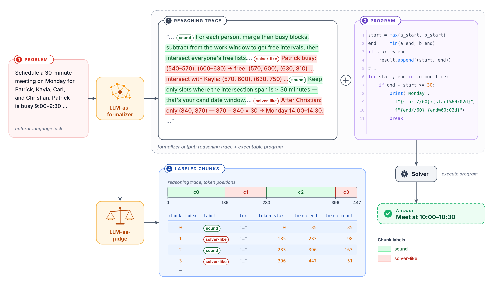

# Solver-Like Behavior In LLMs

Code, data and results for "Solver-Like Behavior in Large Language Models as Formalizers". An LLM used as a formalizer is asked to translate a constraint problem into a program (Python, Z3 or PDDL) and let the program or solver find the answer. Reasoning models often solve the problem themselves in their reasoning first. We call this **solver-like behavior (SLB)**. This repository measures how often SLB happens, what forms it takes, whether it affects accuracy, how it depends on the formal language (FL), and which prompting methods reduce it.



The figure shows the setting: the formalizer writes a reasoning trace and a program, a solver runs the program, and a judge labels the reasoning. It uses the original two-way sound / solver-like labels. The paper's labels come from the SLB ontology described below.

---

## Findings

Full write-ups are in [`docs/results/`](docs/results/). The main ones:

- **SLB is common and redundant** ([hypothesis tests](docs/results/2026-10-31_HYPOTHESIS_TESTS.md)). Under the baseline prompt, 66–96% of traces (depending on the model) contain paragraphs that assign or rule out values, and about a fifth of the reasoning is solver-like. In 50–85% of those traces the program ignores the prose answer and computes the answer itself.
- **Its forms differ in harm.** Most traces that solve in prose state a complete answer. Programs that inherit the prose answer are rare: of 5,357 runnable programs, 54 are hardcoded, 221 partly fixed and 61 steered. When the prose answer is wrong, though, those programs are almost never right.
- **The amount of SLB is not associated with accuracy** when the comparison is within a problem.
- **SLB depends on the formal language.** Python leads to more SLB than Z3 or PDDL on the same problems, most where the other FL hands the search to a solver: BlocksWorld PDDL → Python raises the solver-like ratio by 0.12, and Meeting Python → Z3 lowers it by 0.15 ([cross-FL design](docs/CROSS_FL_DESIGN.md)).
- **Deterrence** ([full runs](docs/results/2026-11-01_DETERRENCE_FULL.md)). Cautionary prompts cut solver-like tokens by 15–23% and leave accuracy unchanged. Batching five problems per prompt cuts them by 62% but costs about 6 accuracy points. Placeholders (values hidden from the model and passed to the program at run time) cut them by 97% with no loss of accuracy.

---

## Tasks, formal languages and models

Each task has 100 problems (`data/problems/`). Every model is run under three prompt conditions: `baseline`, plus the two cautionary suffixes `caution_a` and `caution_b` (`prompts/cautionary/`).

| Task | Native FL | Second FL (cross-FL runs) | Scored by |
|---|---|---|---|
| Calendar Scheduling | Python | Z3-Python | the meeting fits the duration and overlaps no busy interval |
| Meeting Planning | Python | Z3-Python | the itinerary is simulated step by step and must meet at least as many friends as the golden solution |
| ZebraLogic | Z3-Python | Python (stdlib) | the printed grid matches the golden solution |
| BlocksWorld | PDDL | Python (stdlib) | the plan (from Fast Downward for PDDL, printed by the program for Python) is valid under the golden domain and problem (VAL); for the 10 unsolvable instances, the model must show there is no plan |

One unsolvable BlocksWorld instance (`blocksworld_p03_state_constraint3`) cannot be proven unsolvable within 5 minutes, even from the golden PDDL.

| Model | How it runs |
|---|---|
| DeepSeek-V4-Flash | API (`thinking`, `reasoning_effort`) |
| Qwen3.8-27B | local, vLLM, thinking mode via the chat template |
| GPT-OSS-120B | local, vLLM, `reasoning_effort` |
| Gemma 4 31B-it | local, vLLM (FP8, temperature 0, thinking): the ontology judges |

DeepSeek's cross-FL runs are excluded from all analyses because the model behind the API changed between the native runs (2026-08) and the cross-FL runs (2026-10); see [CROSS_FL_DESIGN.md](docs/CROSS_FL_DESIGN.md). The outputs are kept in `output_crossfl/deepseek/`.

`data/problems/` also holds `coin_collector`, `gradeschoolmath` and `trip_planning` datasets, which no current experiment uses.

---

## The SLB ontology

Each trace is labelled on three axes ([docs/SLB_ONTOLOGY.md](docs/SLB_ONTOLOGY.md)):

- **A. Solving in prose.** A1: does any paragraph assign, test or rule out values of the decision variables? A2: does the prose reach a complete answer or a partial one? The **solver-like ratio** is the share of reasoning in A1 Values paragraphs.
- **B. What the program does with it:** hardcoded, partly fixed, steered or independent (or n/a when nothing ran).
- **C. Agreement** (only for complete prose answers): C1, does the prose answer match the program output? C2, is the prose answer correct?

The final judges are A = `gemma_v11t`, B = `gemma_b5t` and A2/C = `gemma_v11c`, assembled under the tag `gemma_v11_b5t`. Their reliability was measured against human labels in `validation/reliability/` ([A judge reliability](docs/results/2026-10-30_A_JUDGE_RELIABILITY.md); paper Table 1).

---

## Setup

```bash
python3 -m venv venv && source venv/bin/activate
pip install -r requirements.txt

# Build Fast Downward and VAL into repos/ (git-ignored; needed for BlocksWorld)
scripts/setup_planners.sh

# API keys and token limits
cp .env.example .env
```

On our server, inference and the judges run in a vLLM venv, and the figure scripts run in a separate venv that has matplotlib and scipy. The tmux helper scripts (`scripts/run_*.sh`) source `/local-ssd/hz466/vllm-test/env.sh`, a server-specific environment script; change that line elsewhere. They also refuse to start on a GPU that already has a process on it.

---

## Pipeline

Each stage reads the previous stage's JSON from `<root>/<model>/<task>/<condition>_<stage>.json`. The root is `output/` for the native runs.

```bash
# 1. Inference: the model writes a reasoning trace and a program
python src/run_inference.py --task calendar --model qwen --n 100            # add --caution-a / --caution-b
GPU=<free GPU> scripts/run_inference_tmux.sh --task calendar --model qwen   # same, in tmux on one GPU

# 2. Execution: extract the final-answer program and run it (Python, Z3, or PDDL via Fast Downward)
python src/run_execution.py --input output/qwen/calendar/baseline_inference.json

# 3. Evaluation: check the output against the task's constraints
python src/run_evaluation.py --input output/qwen/calendar/baseline_execution.json

# 4. Ontology judges over every stored run (one GPU per shard; results in <root>/ontology/)
python src/run_ontology_judges.py a --items all --tag gemma_v11t --thinking 8192 --shard 0/1
python src/run_ontology_judges.py b --items all --tag gemma_b5t --thinking 16384 --shard 0/1
python src/run_ontology_judges.py c --items all --tag gemma_v11c --condense-a-tag gemma_v11t --condense-values-only --shard 0/1

# 5. Assemble per-trace labels -> <root>/<model>/<task>/<cond>_ontology_gemma_v11_b5t.json
python scripts/assemble_ontology_labels.py --tag gemma_v11_b5t --a-tag gemma_v11t --b-tag gemma_b5t --c-tag gemma_v11c
```

`scripts/run_full_v11.sh` and `scripts/run_full_b5t.sh` run step 4 sharded over several GPUs. Use `--output-root output_test` for test runs so stored results are not overwritten.

### Cross-FL runs

`--fl` selects a non-native FL, for example `python src/run_inference.py --task calendar --fl z3 ...`. These runs write to `output_crossfl/`. Execution records each program's FL compliance (`scripts/fl_compliance_report.py`). Drivers: `scripts/run_crossfl_gpu7.sh` (Qwen, GPT-OSS), `run_crossfl_claim.sh` and `run_crossfl_extra.sh` (extra workers), and `run_crossfl_deepseek.sh`. `scripts/run_crossfl_judges.sh` runs the judges with `--root output_crossfl`. Design: [docs/CROSS_FL_DESIGN.md](docs/CROSS_FL_DESIGN.md).

### Deterrence runs

The two methods are batching (`--batch-k K`, condition `batch_k<K>`) and placeholders (`--placeholder`, condition `placeholder`, using `data/placeholders/` from `scripts/build_placeholders.py`). Batched and placeholder outputs are executed with `src/run_execution_deter.py`, then scored with `run_evaluation.py` as usual. `scripts/run_deter.sh` runs the cells for one model on one GPU, and `scripts/deter_dispatch.py` schedules every job on free GPUs. Outputs go to `output_deter/` (native FL), `output_deter_crossfl/` (second FL) and `output_deter_pilot/` (the 20-problem pilot). `scripts/deter_judge_items.py` prepares the A judge's input and `scripts/deter_compare.py` compares each run with the baseline. Design: [docs/DETERRENCE_DESIGN.md](docs/DETERRENCE_DESIGN.md).

### Paper numbers and figures

The paper's LaTeX lives in a separate repository; the figure scripts take its path as `--paper`.

```bash
python scripts/paper_ontology_stats.py --tag gemma_v11_b5t --a-tag gemma_v11t                       # -> output/paper/ontology_traces_<tag>.json
python scripts/paper_ontology_stats.py --tag gemma_v11_b5t --a-tag gemma_v11t --root output_crossfl # -> ..._output_crossfl.json
python scripts/hypothesis_tests.py > docs/results/<date>_HYPOTHESIS_TESTS_raw.md
python scripts/paper_figures_hypotheses.py --paper <paper dir>   # Section 5 figures, output/paper/hypothesis_numbers.json
python scripts/paper_figures.py --paper <paper dir>              # ontology cells figure and appendix table
python scripts/deter_traces.py                                   # -> output/paper/deter_traces_gemma_v11t.json
python scripts/paper_figure_deter.py --paper <paper dir>         # Section 6 figure, output/paper/deter_numbers.json
python scripts/paper_runs_table.py --paper <paper dir>           # appendix table of runs and FL compliance
python scripts/slb_vs_size.py                                    # SLB vs problem size
```

### Re-running after a fix

`scripts/reexecute_changed.py` re-extracts and re-runs only the programs that a code-extraction or scoring fix changes. `scripts/rejudge_changed.sh` then re-judges only the traces whose text changed and reassembles the labels.

---

## Repository layout

```
src/
  run_inference.py, run_execution.py, run_evaluation.py   pipeline stages 1-3
  run_execution_deter.py                                   execution for batched / placeholder runs
  run_ontology_judges.py, ontology_items.py                Gemma ontology judges and their inputs
  general/      I/O, prompts, parsing, CLI, FL compliance
  inference/    model calls, program executors (Python, Z3, PDDL)
  models/       DeepSeek, Qwen, GPT-OSS clients
  execution/    code extraction, output formatting
  evaluation/   task validators
  deter/        batching and placeholder construction
  hardcoded/    rule-based hardcoding checker (static_checker.py); legacy Gemini batch judge
  chunking/     reasoning splitter (used by the ontology items); legacy Gemini chunking judge
  run_chunking.py, run_chunking_local.py, run_hardcoded.py  legacy judges (see below)
data/           problems, constraints, placeholder versions of Calendar and Meeting
prompts/        prefixes per FL, output formats, cautionary suffixes, deterrence prompts, judge prompts
scripts/        drivers, analysis, paper numbers and figures, reliability sheets
validation/     human and judge labels for the reliability checks
docs/           design notes, ontology, guides; docs/results/ has dated result write-ups
tests/          unit and smoke tests
output/         native runs: per-run JSONs and assembled ontology labels; output/paper/ has the paper's numbers
output_crossfl/, output_deter/, output_deter_crossfl/, output_deter_pilot/   see above
```

The raw judge outputs (`*/ontology/`), judge caches, logs, `repos/` and the scratch roots (`output_test/`, `output_rerun*/`, `output_backup/`) are not tracked in git.

---

## Tests

```bash
python tests/execution/test_code_extraction.py
python tests/batch/test_result_mapping.py
python tests/split/test_reasoning_splitter.py
python tests/split/test_chunk_stitching.py
python tests/chunking/test_split_behavior.py
python tests/smoke/test_evaluation.py tests/smoke/deepseek_output   # writes *_evaluation.json into that directory
```

`tests/smoke/test_inference.py` and `test_chunking.py` call the models or the Gemini judge. `tests/judge/` and `tests/vllm/` hold one-off judge and vLLM checks.

---

## Legacy: Gemini chunking and hardcoded judges

Before the ontology, a Gemini 2.5 Pro judge on Vertex AI split each trace into "sound" and "solver-like" chunks (`src/run_chunking.py`, or `src/run_chunking_local.py` with a local model), and a second judge labelled programs as hardcoded or not (`src/run_hardcoded.py`). Their outputs are still in `output/` as `*_chunking.json`, `*_chunking_rekeyed.json` and `*_hardcoded.json`, along with an early ontology run (`*_ontology_gemma_v1.json`). The batch judges mapped results to examples by position while Vertex shuffles batch output. This is fixed, and `scripts/rekey_chunking.py` repaired the stored chunking files where possible (its docstring explains how). These labels are not used in the paper.

The following docs describe that earlier pipeline and its results: [USAGE_GUIDE.md](docs/USAGE_GUIDE.md), [RESULTS.md](docs/RESULTS.md), `docs/guides/` (chunking, batch judging, hardcoded detection, output schema, cautionary suffix, code extraction, PDDL workflow), and the results docs dated before 2026-10-22. The same is true of `tables/*.xlsx` and the analysis scripts `generate_*`, `analyze_hardcoded_results.py` and `fix_empty_chunks.py`.

---

## Authors

[ANONYMOUS AUTHORS]

## Advisors

[ANONYMOUS ADVISORS]

## License

This project is licensed under the terms in `LICENSE`.
