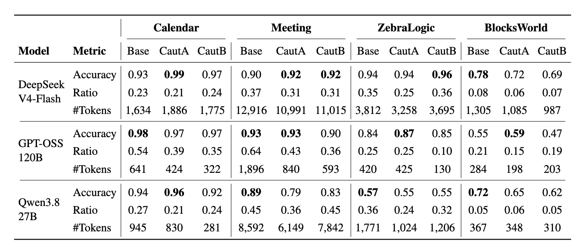

# Solver-Like Behavior In LLMs

This repository supports a research project investigating solver-like behavior in LLM reasoning chains during formalization tasks, and understand what influences this behavior, as well as how it impacts accuracy.

## Overview

This research pipeline analyzes how LLMs approach constraint satisfaction problems (CSPs) when asked to formalize and solve them. We track whether models solve problems in natural language reasoning ("solver-like") versus properly formalizing them in code ("sound").

### Pipeline Architecture


The pipeline consists of three main stages:

1. **Inference** → LLM receives a CSP problem and generates reasoning traces with executable code
2. **Evaluation** → Code is executed and outputs are validated against task-specific constraints
3. **Chunking** → An LLM judge classifies reasoning into "sound" (formalization) vs "solver-like" (natural language solution) segments

### Key Results



**Key Findings:**
- **Accuracy**: Models achieve 47-99% accuracy across tasks (Calendar highest, BlocksWorld lowest)
- **Solver-like Ratio**: Proportion of reasoning spent solving vs formalizing (0.05-0.64)
- **Cautionary Prompts**: Anti-solver prompts (CautA, CautB) have mixed effects—sometimes improve accuracy (DeepSeek Calendar: 0.93→0.99), sometimes degrade (all models on BlocksWorld)
- **Token Efficiency**: Average reasoning tokens range from 130 (ZebraLogic) to 12,916 (Meeting)

---

## Quick Start

### 1. Setup

```bash
# Create virtual environment
python3 -m venv venv
source venv/bin/activate

# Install dependencies
pip install -r requirements.txt

# Configure .env with your API keys (see .env.example)
```

### 2. Run Pipeline

```bash
# Stage 1: Inference (run models, execute code)
python src/run_inference.py --task calendar --model deepseek --n 10

# Stage 2: Evaluation (check constraints)
python src/run_evaluation.py --input output/deepseek/calendar/inference.json

# Stage 3: Chunking (classify reasoning)
python src/run_chunking.py \
  --input output/deepseek/calendar/inference.json \
  --judge-prompt prompts/judge/llm_as_judge_for_chunking.txt
```

### 3. View Results

```bash
# Results are in output/{model}/{task}/
ls output/deepseek/calendar/
# → inference.json evaluation.json chunking.json
```

---

## Features

✅ **Clean, modular architecture** - DRY principles, no duplicated logic
✅ **Incremental JSON writing** - Memory-efficient processing of large datasets
✅ **Progress visualization** - Live progress bars with success/error counts
✅ **Fail-safe error handling** - Continue on errors, track failures
✅ **Task-specific validation** - Calendar scheduling & meeting planning constraints
✅ **Vertex AI integration** - Gemini judge for reasoning classification
✅ **Token counting** - Precise metrics using tiktoken

---

## Documentation

- **[USAGE_GUIDE.md](docs/USAGE_GUIDE.md)** - ⚡ Quick start and complete usage guide (start here!)
- **[RESULTS.md](docs/RESULTS.md)** - Comprehensive experimental results across models and tasks
- **[OUTPUT_SCHEMA.md](docs/OUTPUT_SCHEMA.md)** - JSON output format specification
- **[CAUTIONARY_SUFFIX.md](docs/CAUTIONARY_SUFFIX.md)** - Baseline vs caution condition comparison
- **[CLAUDE.md](CLAUDE.md)** - Architecture & design decisions

---

## Models Supported

- **DeepSeek-V4-Flash** (API) - Reasoning via `thinking` + `reasoning_effort`
- **Qwen3.8-27B** (Local HuggingFace) - Reasoning via `enable_thinking`
- **GPT-OSS-120B** (Local HuggingFace) - Reasoning via `reasoning_effort`

---

## Tasks Supported

- **Calendar Scheduling** - Find meeting time for multiple participants
- **Meeting Planning** - Build consistent itinerary with travel/waiting

---

## Project Structure

```
.
├── src/
│   ├── run_inference.py      # Stage 1: Model inference
│   ├── run_evaluation.py     # Stage 2: Constraint validation
│   ├── run_chunking.py       # Stage 3: Reasoning classification
│   ├── general/              # Shared utilities (I/O, prompts, parsing, CLI)
│   ├── inference/            # Model calling, code execution
│   ├── evaluation/           # Task-specific constraint checking
│   └── chunking/             # Judge calling, chunk parsing
├── data/
│   ├── problems/             # Problem datasets (100 examples each)
│   └── constraints/          # Constraint definitions for evaluation
├── prompts/                  # Prompt templates (CSP framing, output formats, judge)
├── output/                   # Pipeline outputs (organized by model/task)
└── docs/                     # Documentation
```

---

## Example Output

```bash
$ python src/run_inference.py --task calendar --model deepseek --n 5

=== Inference Pipeline ===
Task: calendar
Model: deepseek
Examples: 5

Loading problems...
Loaded 5 examples
Loading prompts...
Prompts loaded
Output: output/deepseek/calendar/inference.json

Processing calendar | 5/5 [00:23<00:00, success=5, errors=0]

✓ Inference complete!
  Success: 5/5
  Errors: 0/5
  Output: output/deepseek/calendar/inference.json
```

---

## Requirements

- Python 3.10+
- DeepSeek API key (for DeepSeek model)
- Google Cloud project with Vertex AI enabled (for judge)
- Optional: GPU for local models (Qwen, GPT-OSS)

---

## Authors

[ANONYMOUS AUTHORS]

## Advisors

[ANONYMOUS ADVISORS]

## License

This project is licensed under the terms in `LICENSE`.

